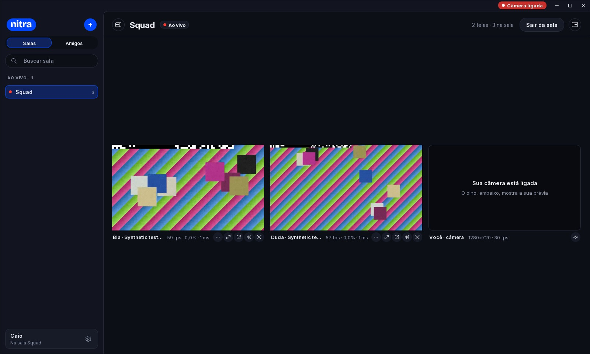
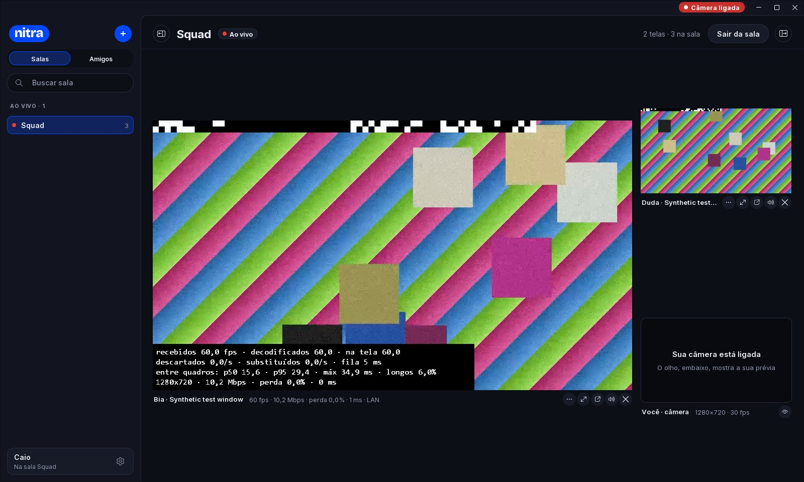
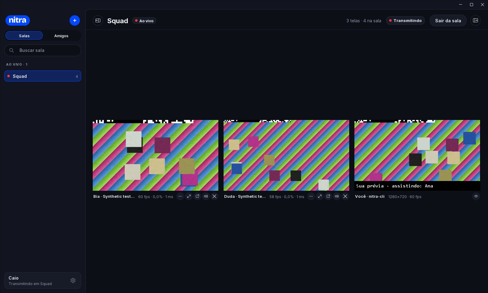
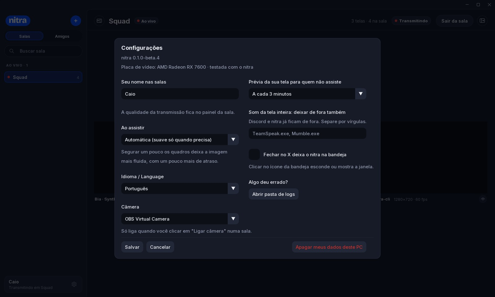
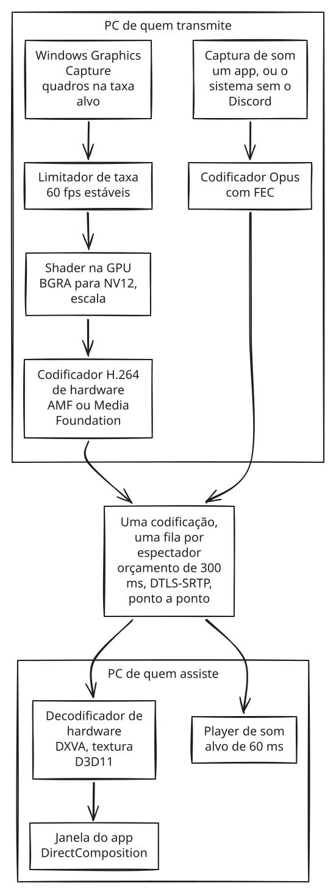
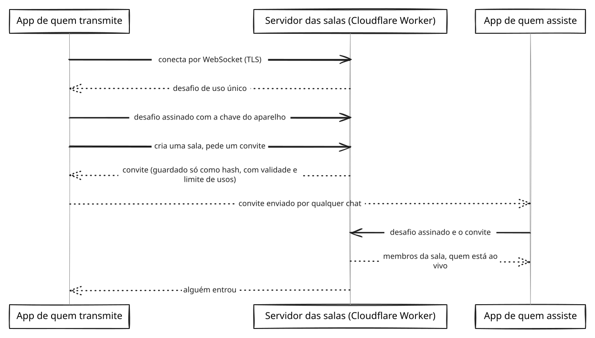
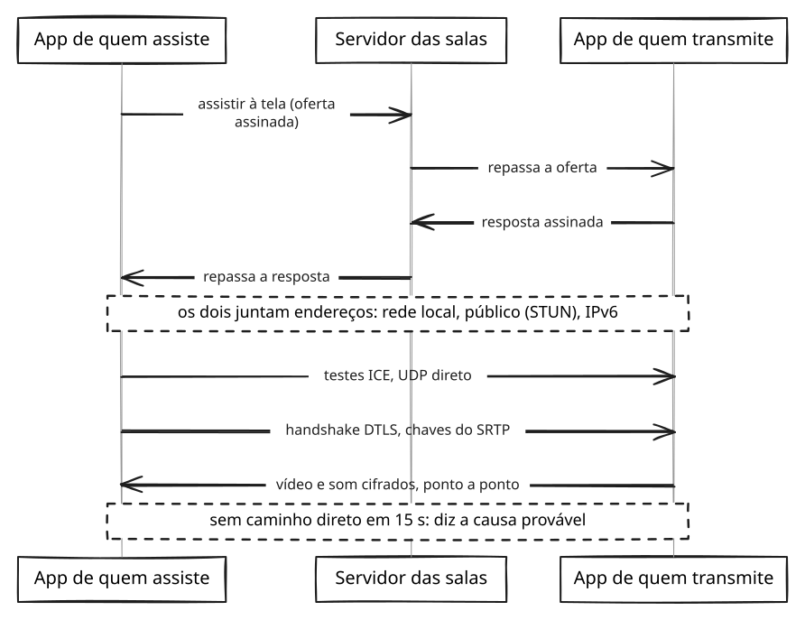

<p align="center"></p>

# nitra

Compartilhamento de tela com baixa latência para Windows, feito em Rust para poucos amigos de cada vez. Você transmite um jogo ou uma janela numa sala; até três amigos assistem ao vivo, ponto a ponto, enquanto o jogo continua rodando liso.

> **Status:** beta privada (`0.1.0-beta.4`). Desenvolvido numa AMD Radeon RX 7600 com Windows 11; usuários da beta já transmitiram e assistiram com uma RTX 2060, uma RTX 3050 e uma RX 6750 XT. Intel é experimental (veja [Hardware](#hardware)).

**Leia em:** [English](README.md) · Português (Brasil)

## Recursos

- **Crie uma sala** e mande o convite; todo mundo nela vê quem está online e quem está ao vivo. Várias pessoas podem transmitir ao mesmo tempo, e dá para assistir a mais de uma tela lado a lado, destacar uma ou ir para tela cheia.
- **Amigos**, salas de duas pessoas numa aba própria: adicione alguém com um convite de uso único, ou peça amizade a alguém de uma sala. Qualquer um dos dois pode desfazer, para os dois.
- **Uma câmera ao lado da tela.** Cada pessoa pode transmitir uma tela e uma câmera, cada uma no seu card: assista às duas ao mesmo tempo (até da mesma pessoa), destaque uma, deixe uma flutuando sobre o jogo. Funciona qualquer câmera que o Windows ofereça, pelo Media Foundation ou pelo DirectShow (a OBS Virtual Camera, o Iriun e afins), em até 720p30. Ela nunca liga sozinha, e enquanto está ligada um selo vermelho "Câmera ligada" fica à vista, inclusive em tela cheia.
- **Clique num card para assistir**, ajuste o volume de cada tela (lembrado por pessoa) e deixe qualquer tela ou câmera assistida numa janelinha flutuante por cima de todas as outras, inclusive do jogo, para arrastar e redimensionar onde quiser.
- **Transmita uma tela ou uma única janela**, com o som dela: uma janela transmite só o áudio do próprio app; uma tela inteira transmite o som do sistema sem o Discord, o nitra e os apps que você excluir. **Troque** para outra tela ou janela sem encerrar a transmissão: quem assiste continua conectado e a imagem muda em cerca de 0,2 s.
- **Veja a sua própria transmissão**, como no OBS ou no Discord: uma prévia ao vivo opcional no seu card, desligada por padrão. O painel de transmitir pode ser escondido para dar mais espaço às telas.
- **Predefinições de qualidade:** 720p60 a 6 Mbps (o padrão), 1080p60, 1080p30 (bom para filmes) e 1440p60, além de um 720p30 econômico a 2 Mbps para uploads lentos, com um ajuste avançado de taxa de bits. A imagem mantém as proporções quando a fonte muda de formato.
- **Suave ou imediato:** cada espectador escolhe atraso mínimo, suave (uma espera de até dois quadros) ou automático, que espera só o quanto a rede precisa.
- **Prévias cifradas** de cada tela ao vivo para quem está na sala e não está assistindo.
- **Números ao vivo** em cada tela assistida: taxa de quadros, taxa de bits, perda de pacotes, tempo de ida e volta e o caminho da conexão (rede local, internet, IPv6). Quem transmite vê quem está assistindo, com a perda e o tempo de ida e volta de cada um. Quando a conexão direta falha, o app diz por quê.
- **Fecha como um app normal.** O X fecha o nitra; enquanto ele roda, um ícone na bandeja esconde e mostra a janela com um clique. Se preferir, ele também pode ficar na bandeja ao fechar.
- **Uma janela por perfil**, e mensagens claras quando uma janela transmitida fecha, um monitor some ou o PC suspende.
- **Se recupera sozinho** de uma GPU perdida (reinício do driver), da suspensão e de mudanças de tela.
- **Em português ou inglês**, seguindo o Windows ou escolhido nas configurações.

## Capturas de tela

<table>
  <tr>
    <td width="50%"><br><sub><b>Uma sala:</b> duas telas assistidas lado a lado, cada uma com a sua taxa de quadros, perda e tempo de ida e volta, e a câmera ligada (selo na barra de título).</sub></td>
    <td width="50%"><br><sub><b>Assistindo:</b> uma tela em destaque, com os números ao vivo sobre o vídeo (quadros recebidos, decodificados e mostrados, espaçamento, taxa de bits, perda, rota).</sub></td>
  </tr>
  <tr>
    <td width="50%"><br><sub><b>Transmitindo:</b> a prévia ao vivo da sua própria transmissão, com quem está assistindo, ao lado das telas que você assiste.</sub></td>
    <td width="50%"><br><sub><b>Configurações:</b> fluidez, idioma, câmera, o filtro de som da tela inteira, a pasta de logs e apagar os seus dados.</sub></td>
  </tr>
</table>

As telas mostram a fonte de teste sintética do nitra (listras e quadrados em movimento), transmitida por pessoas fictícias num servidor de salas local.

## Instalar, usar e remover

1. Baixe o `nitra.exe` e confira o SHA-256 dele com o que foi publicado junto. É um arquivo só, com o runtime do C embutido; não há instalador.
2. Abra. O Windows pode mostrar "O Windows protegeu o computador" porque o arquivo não é assinado: clique em **Mais informações → Executar assim mesmo**.
3. Digite o seu nome, crie uma sala e copie o convite para os seus amigos. Eles colam no nitra deles para entrar.

O nitra guarda os dados numa pasta só, `%LOCALAPPDATA%\nitra`: a chave do aparelho (protegida pelo DPAPI do Windows), as suas salas, as suas configurações e os últimos dez logs. Ele não grava mais nada: nem chaves de registro, nem arquivos temporários, nem cache. As configurações mostram a versão e têm o botão **Abrir pasta de logs** para quando algo der errado.

**Atualizações.** Ao abrir, e uma vez por dia enquanto está aberto, o nitra pergunta ao GitHub qual é a última release. Quando há uma mais nova, ele avisa e pergunta: **Atualizar agora**, **Depois** ou **Ver novidades**. Ele nunca atualiza sozinho. Em **Atualizar agora**, ele baixa a release, confere a assinatura (veja [Segurança](#segurança)), troca o `nitra.exe`, fecha e abre de novo na versão nova; se alguma conferência falhar, nada muda e ele diz por quê. **Procurar atualizações**, nas configurações, desliga a pergunta. A consulta só mostra ao GitHub o endereço de onde ela vem, como qualquer site vê; nenhum nome, chave ou sala vai junto.

**Para remover o nitra,** use **Apagar meus dados deste PC** nas configurações (ele pergunta antes, fecha o nitra e apaga essa pasta) e depois apague o `nitra.exe`. O próprio Windows pode manter uma regra de firewall se você liberou o nitra no firewall; ela é inofensiva.

## Hardware

| GPU | Transmitir (codificar) | Assistir (decodificar) |
| --- | --- | --- |
| AMD | **Testada** (AMF; RX 7600, RX 6750 XT) | **Testada** (decodificador H.264 do Windows, DXVA) |
| NVIDIA | **Testada** (Media Foundation / NVENC; RTX 2060, RTX 3050) | **Testada** (decodificador H.264 do Windows, DXVA) |
| Intel | Experimental (Media Foundation / Quick Sync) | Decodificador H.264 do Windows (DXVA) |

As medições abaixo são da RX 7600; as outras placas foram testadas por usuários da beta, transmitindo e assistindo, sem benchmark. O nitra ainda pergunta antes da primeira transmissão na NVIDIA e na Intel. O nitra nunca codifica por software, porque isso pesaria no jogo; sem um codificador H.264 de hardware, ele avisa e sugere atualizar o driver.

## Limitações conhecidas

- **Notebooks com duas GPUs:** o nitra usa a primeira, que pode ser a integrada enquanto o jogo roda na outra.
- **Sem servidor de relay:** quando um NAT restrito ou um firewall bloqueia a conexão direta dos dois lados, a transmissão não começa; o app diz qual lado é a causa provável. O `nat-probe.exe` (neste repositório) testa uma rede em cerca de 25 segundos e diz se uma conexão direta é provável, sem guardar o endereço IP público.
- **Muita perda de pacotes:** com 5–10% de perda, os keyframes em 1080p podem perder pacotes que não são recuperados, e a imagem pode congelar por alguns segundos (veja [Rede](docs/benchmarks-pt-BR.md#rede)).
- **A janela flutuante** fica acima das outras janelas, mas um jogo em tela cheia exclusiva a cobre (um limite do Windows); tela cheia sem bordas funciona.
- Ainda sem teste de estresse em sessões de várias horas ou em centenas de ciclos de iniciar e parar.

## Como funciona

### A imagem e o som

<picture>
  <source media="(prefers-color-scheme: dark)" srcset="docs/flow/media-pt-dark.svg">
  
</picture>

Os quadros ficam na GPU, como texturas D3D11, da captura até o codificador; nenhum pixel passa pela memória da CPU. Uma codificação serve a todos os espectadores. Vídeo e som compartilham um mesmo relógio, então ficam sincronizados em quem assiste.

### Entrando numa sala

<picture>
  <source media="(prefers-color-scheme: dark)" srcset="docs/flow/rooms-pt-dark.svg">
  
</picture>

Não há contas nem senhas. O servidor das salas é um Cloudflare Worker com um Durable Object por sala; ele cuida da entrada, da presença, da sinalização e das prévias lacradas, nunca da mídia.

### Começando a assistir

<picture>
  <source media="(prefers-color-scheme: dark)" srcset="docs/flow/watch-pt-dark.svg">
  
</picture>

### Prévias

<picture>
  <source media="(prefers-color-scheme: dark)" srcset="docs/flow/preview-pt-dark.svg">
  
</picture>

Os diagramas são desenhados com o Excalidraw; as fontes estão em [`docs/flow`](docs/flow).

### Decisões principais

- **Windows Graphics Capture** em vez do Desktop Duplication: o mesmo impacto no jogo, ou menor, com um terço da CPU.
- **Um shader na GPU** para conversão de cor e escala: mais rápido que o video processor (0,22% contra 0,30% da GPU em 1080p60; 0,14% contra 0,62% em 720p).
- **AMF** como codificador na AMD: 2,3 ms contra 5,9 ms do Media Foundation, que continua sendo o caminho nas outras GPUs.
- **str0m** para o WebRTC em vez do crate `rtc`: com 2% de perda de pacotes, entregou 1.789 de 1.800 quadros a 1,0 ms (p50), contra 1.256 a 900 ms, e quem entrou depois recebeu um keyframe em 101 ms em vez de 493 ms.
- **Dear ImGui** para a interface em vez do GPUI: dorme quando nada muda (0% de CPU contra 1,2%, que acordava cerca de 650 vezes por segundo), abre duas vezes mais rápido e não tem custo mensurável no jogo, enquanto o GPUI custava 4% do 1% low.
- **Ponto a ponto, 1–3 espectadores,** sem servidor de mídia e sem relay: nada para pagar ou manter além do Worker gratuito.
- **Sem codificador por software como reserva:** ele pesaria na CPU e passaria pixels pela memória enquanto o jogo roda.

## Desempenho desde o projeto

O objetivo é um jogo que continua liso enquanto é transmitido. Cada escolha abaixo foi medida, em A/B, contra a alternativa.

**Captura e codificação**
- **Só GPU, da captura ao codificador.** Os quadros ficam como texturas D3D11; conversão de cor e escala rodam numa única passada de shader para um conjunto fixo de texturas NV12.
- **Capturar só o que é enviado.** O Windows Graphics Capture é pedido na taxa alvo, calculada a partir da taxa de atualização do monitor capturado, em vez de todo quadro que o jogo desenha (cerca de 114 por segundo a 60 fps).
- **60 fps estáveis.** Um limitador de taxa por créditos absorve as rajadas na entrega de quadros do jogo, então nenhum quadro da fonte é descartado e quem assiste recebe ~59,9 fps estáveis.
- **Codificação assíncrona com filas limitadas.** No máximo 4 quadros ficam no codificador ao mesmo tempo; toda fila tem tamanho fixo, então nada cresce sem limite sob carga.
- **Imagem na hora para quem chega depois.** Quando a fonte está minimizada ou parada, o último quadro é codificado de novo a pedido, então um espectador novo nunca espera numa tela preta.

**Rede**
- **Uma codificação para todos.** Cada espectador só adiciona o custo de enviar os pacotes: cerca de 4% de um núcleo, mais ou menos 0,25% do processador inteiro.
- **Conexões lentas não seguram as outras.** Cada espectador tem um orçamento de envio de 300 ms; um espectador numa conexão lenta pula quadros e volta no próximo keyframe, enquanto o codificador acompanha o espectador mais lento que consegue acompanhar. Os keyframes são limitados a um a cada 500 ms, não importa quantos espectadores peçam.
- **Retransmissões numa janela larga.** Pacotes perdidos são pedidos de novo ao longo do último ~1 s de vídeo, em vez dos ~110 ms do str0m, então 2–5% de perda são corrigidos sem keyframe nem congelamento.
- **Som que recupera o atraso.** Opus com correção de erros e ocultação de perdas. O som atrasado é limitado a 40 ms, e depois de uma travada da rede o player descarta o acumulado de uma vez, em vez de voltar aos poucos ao longo de meio minuto.
- **Pacotes malformados ou grandes demais são descartados,** sem nunca encerrar a sessão.

**Assistir**
- **Um dispositivo de vídeo para todas as telas assistidas.** Os decodificadores rodam no próprio dispositivo D3D11 da janela, em vez de um cada, então uma tela assistida custa cerca de 50 MB em vez de cerca de 80 MB, sem CPU a mais.
- **Menos superfícies no decodificador.** Os dois codificadores preveem cada quadro só a partir do anterior, mas declaravam quatro quadros de referência; o decodificador do Windows calcula as superfícies a partir desse número (referências + 7). Declarar um dá as mesmas imagens, bit a bit, e 8 superfícies por tela assistida em vez de 11: 9 MB a menos de memória de vídeo em 720p e 19 MB a menos em 1080p.
- **Telas escondidas não são desenhadas.** Quando uma tela assistida está minimizada ou coberta, o desenho para: 0% de carga 3D, 40% menos despertares e 14 MB a menos de memória de vídeo.
- **A janela passa pelo compositor da área de trabalho** (DirectComposition), então uma janela maximizada nunca toma a taxa de atualização do monitor e o mouse continua liso.
- **Nada roda quando nada muda.** A janela dorme até haver entrada ou um quadro novo: 0% de CPU em repouso, e ela abre em cerca de 106 ms.

**Servidor das salas**
- **As salas dormem entre as mensagens.** Cada sala é um Durable Object com WebSockets que hibernam; os pings de manutenção são respondidos pelo runtime sem acordar a sala, então uma sala quieta custa uma requisição por minuto.

## Desempenho em resumo

Medido num Ryzen 7 5800XT com uma RX 7600 (CPU como parcela de um núcleo e, entre parênteses, do processador inteiro):

| | Resultado |
| --- | --- |
| Transmitindo enquanto joga, jogo limitado a 300 FPS, OBS gravando | sem diferença mensurável no FPS nem no 1% low |
| Transmitindo enquanto joga, sem limite | −5,6% no FPS médio, quase tudo da própria captura |
| Do quadro renderizado à tela de quem assiste (mesmo PC, AMF) | 10,3–11,2 ms (p50) |
| Cada espectador a mais | cerca de 4% de um núcleo (0,25%); a codificação roda uma vez para todos |
| O app em repouso, numa sala ou na bandeja | 0% de CPU, 24 MB no Gerenciador de Tarefas |
| Assistindo a uma tela 720p60 | +9 MB no Gerenciador de Tarefas; um espectador sozinho usa 50 MB de memória de vídeo |
| Transmitindo uma câmera | 1,5% de um núcleo (0,09%) |
| 2–5% de perda de pacotes | corrigidos sem keyframe nem congelamento |

Todos os números, com o método e as alternativas com que foram comparados, estão na [**página de benchmarks**](docs/benchmarks-pt-BR.md).

## Segurança

- **Sem contas nem senhas.** Cada aparelho tem um par de chaves; a chave privada é protegida pelo DPAPI do Windows. As salas fazem a entrada por desafio e resposta com essa chave.
- **Mensagens assinadas**, com validade e proteção contra repetição. Convites manuais funcionam uma vez; convites de sala são guardados só como hashes, com validade e limite de usos.
- **Mídia cifrada**, ponto a ponto (DTLS-SRTP). As prévias são lacradas para cada membro da sala (X25519 e AES-256-GCM), e o servidor não consegue abri-las.
- **Sem endereços IP nos logs.** Os detalhes de conexão são registrados só como tipos e caminhos, e o Worker não guarda logs de requisições. O `scripts/check-logs.ps1` confere os logs atrás de endereços, convites, e-mails e segredos.
- **Protegido contra entradas malformadas:** testes de fuzz em todo leitor de dados de fora (protocolo das salas, convites, envelopes assinados, STUN, arquivos de perfil, prévias), de 1.000 a 50.000 entradas alteradas cada. As prévias só aceitam JPEG. Datagramas grandes demais são descartados em vez de encerrar a sessão. Os ids de transação do STUN vêm do gerador aleatório criptográfico do sistema.
- **Releases assinadas.** O `SHA256SUMS.txt` de cada release é assinado com a chave de release (Ed25519), e a metade pública dela vai dentro do nitra. Antes de instalar uma atualização, o nitra confere essa assinatura e se o `nitra.exe` baixado tem o SHA-256 assinado; um arquivo alterado no caminho, ou uma release feita por qualquer outra pessoa, é recusado. Nem quem controlasse a conta do GitHub conseguiria publicar uma atualização que funcione sem a chave, que nunca sai do PC do mantenedor: lá ela fica protegida pelo DPAPI, e o único backup é lacrado com uma senha (PBKDF2-SHA256 e AES-256-GCM). Um `nitra-cli` compilado deste repositório confere um download à mão com `--release-verify SHA256SUMS.txt`.
- **Dependências auditadas** com o `cargo audit`: 147 dependências, 0 vulnerabilidades conhecidas.
- **Segurança da GPU:** só APIs documentadas de modo usuário. O nitra nunca mexe em clocks, voltagens, limites de energia, drivers ou nas configurações de TDR.

## Compilando

Requisitos: Windows 10 ou 11, o toolchain do Rust fixado em `rust-toolchain.toml` e a libopus e o FreeType estáticos do vcpkg (o runtime do C é ligado junto, veja `.cargo/config.toml`):

```powershell
vcpkg install opus:x64-windows-static freetype[core]:x64-windows-static
cargo build --release -p nitra
.\scripts\check.ps1
```

O `check.ps1` roda a formatação, o clippy e os testes. Uma compilação normal é de desenvolvimento, com a sua própria pasta de dados (`nitra-dev`) e o servidor de salas de desenvolvimento; definir `NITRA_CHANNEL=beta` na compilação gera a versão beta. O Worker das salas fica em `worker/` (TypeScript, Wrangler, Node.js 22 ou mais novo).

**Publicando uma versão.** O `scripts/release.ps1` confere, compila a beta e grava o `nitra.exe` e o `SHA256SUMS.txt` em `target\dist\nitra-<versão>\`. Com `NITRA_RELEASE_KEY` apontando para a chave de release, ele também grava o `SHA256SUMS.txt.sig` e o confere com a chave embutida naquela compilação. Uma release do GitHub com a tag `v<versão>` (nem rascunho, nem pre-release) e esses três arquivos é o que as cópias instaladas recebem como atualização. A chave é criada uma vez com `nitra-cli --release-keygen <pasta>` (ele pede a senha do backup) e recriada a partir do backup com `nitra-cli --release-key-restore <backup> --release-key <arquivo>`.

A fonte da interface é a [Inter](https://github.com/rsms/inter) e o logo usa a Bricolage Grotesque, as duas sob a SIL Open Font License; a Inter vai dentro do executável, a partir de `apps/nitra/assets/fonts` (licença no `OFL.txt` de lá).

## Licença

O nitra é distribuído sob a [licença MIT](LICENSE). O `vendor/str0m` mantém a sua própria licença MIT/Apache-2.0, e as fontes mantêm a SIL Open Font License.
