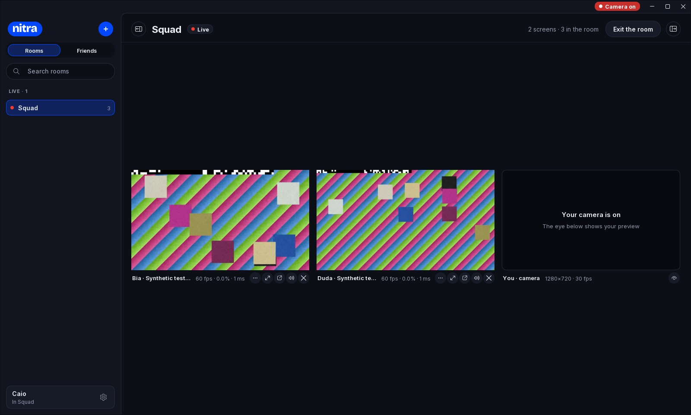
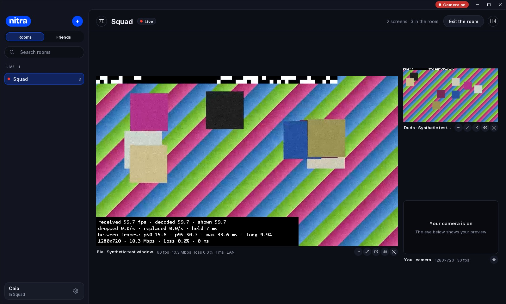
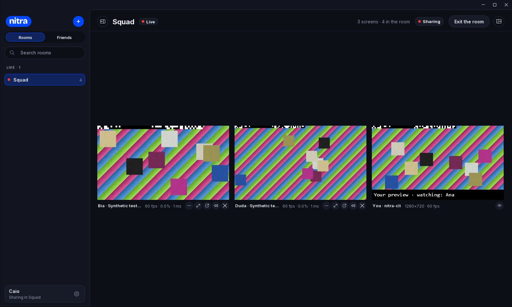
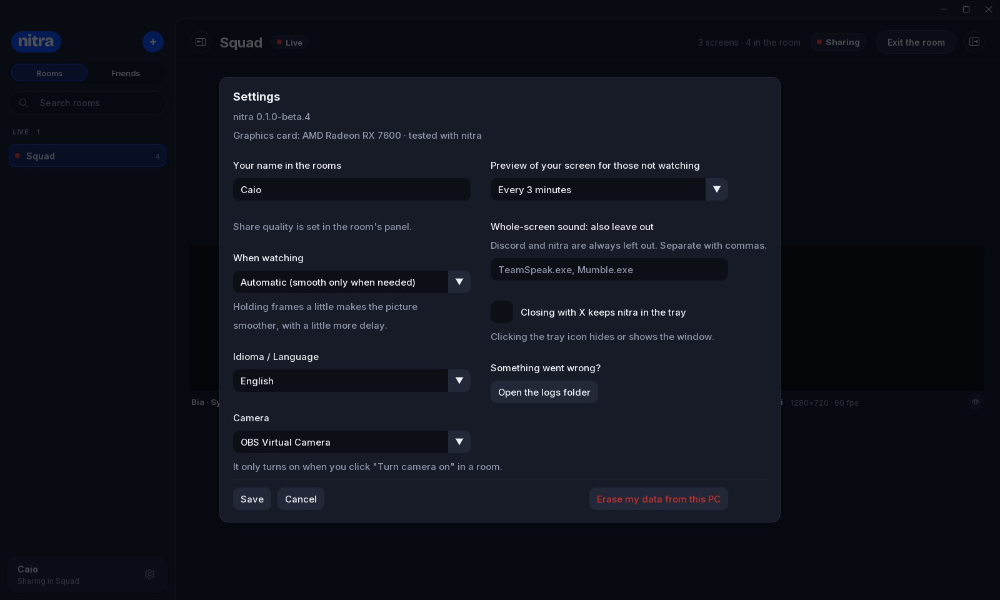
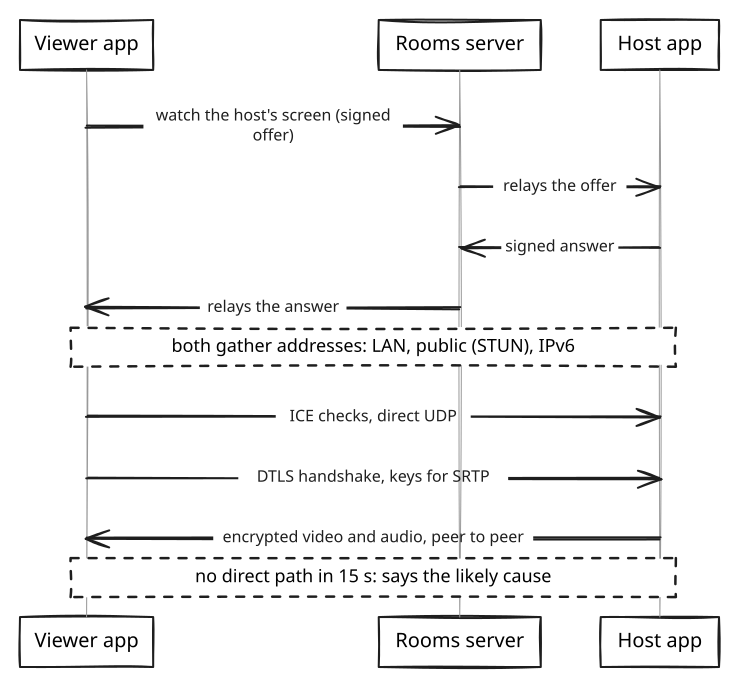

<p align="center"></p>

# nitra

Low-latency screen sharing for Windows, built in Rust for a few friends at a time. You share a game or a window in a room; up to three friends watch it live, peer to peer, while the game keeps running smoothly.

> **Status:** private beta (`0.1.0-beta.4`). Developed on an AMD Radeon RX 7600 with Windows 11; beta users have shared and watched with an RTX 2060, an RTX 3050 and an RX 6750 XT. Intel is experimental (see [Hardware](#hardware)).

**Read in:** English · [Português (Brasil)](README-pt-BR.md)

## Features

- **Create a room** and send the invite; everyone in it sees who is online and who is live. Several people can share at once, and you can watch more than one screen side by side, focus one, or go full screen.
- **Friends**, rooms of two in their own tab: add someone with a single-use invite, or ask someone of a room to be your friend. Either of you can end it, for both.
- **A camera beside the screen.** Each person can share a screen and a camera, each its own card: watch both at once (even from the same person), focus one, float one above the game. Any camera Windows offers works, through Media Foundation or DirectShow (the OBS Virtual Camera, Iriun and the like), at up to 720p30. It never turns on by itself, and while it is on a red "Camera on" badge stays in sight, full screen included.
- **Click a card to watch it**, set each screen's volume (remembered per person), and float any watched screen or camera in a small window above every other, game included, to drag and resize anywhere.
- **Share a screen or a single window**, with its own sound: a window shares only its app's audio; a whole screen shares the system sound minus Discord, nitra and any app you exclude. **Switch** to another screen or window without ending the share: viewers stay connected and the picture changes in about 0.2 s.
- **See your own share**, as in OBS or Discord: an optional live preview on your card, off by default. The share panel can be hidden to give the screens more room.
- **Quality presets:** 720p60 at 6 Mbps (the default), 1080p60, 1080p30 (good for movies) and 1440p60, plus an economy 720p30 at 2 Mbps for slow uploads, with an advanced bitrate setting. The picture keeps its proportions when the source changes shape.
- **Smooth or immediate:** each viewer chooses minimum delay, smooth (a hold of up to two frames) or automatic, which holds only as much as the network needs.
- **Encrypted previews** of each live screen for people in the room who are not watching.
- **Live numbers** on every watched screen: frame rate, bitrate, packet loss, round trip and the connection route (LAN, internet, IPv6). The person sharing sees who is watching, with their loss and round trip. When a direct connection fails, the app says why.
- **Closes like a normal app.** The X closes nitra; while it runs, a tray icon hides and shows the window with one click. It can also stay in the tray when closed, if you prefer.
- **One window per profile**, and clear messages when a shared window closes, a monitor goes away or the PC sleeps.
- **Recovers by itself** from a lost GPU (driver reset), sleep and display changes.
- **In Portuguese or English**, following Windows or chosen in the settings.

## Screenshots

<table>
  <tr>
    <td width="50%"><br><sub><b>A room:</b> two screens watched side by side, each with its frame rate, loss and round trip, and the camera on (badge in the title bar).</sub></td>
    <td width="50%"><br><sub><b>Watching:</b> one screen focused, with the live numbers over the video (frames received, decoded and shown, spacing, bitrate, loss, route).</sub></td>
  </tr>
  <tr>
    <td width="50%"><br><sub><b>Sharing:</b> a live preview of your own share, with who is watching it, beside the screens you watch.</sub></td>
    <td width="50%"><br><sub><b>Settings:</b> smoothing, language, camera, the whole-screen sound filter, the logs folder and erasing your data.</sub></td>
  </tr>
</table>

The screens show nitra's synthetic test source (stripes and moving squares), shared by fictional people on a local rooms server.

## Install, use and remove

1. Download `nitra.exe` and check its SHA-256 against the one published with it. It is a single file with the C runtime built in; there is no installer.
2. Run it. Windows may show "Windows protected your PC" because the file is not signed: click **More info → Run anyway**.
3. Type your name, create a room and copy the invite to your friends. They paste it in their nitra to join.

nitra keeps its data in one folder, `%LOCALAPPDATA%\nitra`: the device key (protected by Windows DPAPI), your rooms, your settings and the last ten logs. It writes nothing else: no registry keys, temporary files or cache. The settings show the version and have an **Open the logs folder** button for when something goes wrong.

**To remove nitra,** use **Erase my data from this PC** in the settings (it asks first, closes nitra and deletes that folder), then delete `nitra.exe`. Windows itself may keep a firewall rule if you allowed nitra through the firewall; it is harmless.

## Hardware

| GPU | Sharing (encode) | Watching (decode) |
| --- | --- | --- |
| AMD | **Tested** (AMF; RX 7600, RX 6750 XT) | **Tested** (Windows H.264 decoder, DXVA) |
| NVIDIA | **Tested** (Media Foundation / NVENC; RTX 2060, RTX 3050) | **Tested** (Windows H.264 decoder, DXVA) |
| Intel | Experimental (Media Foundation / Quick Sync) | Windows H.264 decoder (DXVA) |

The measurements below come from the RX 7600; the other cards were tested by beta users, sharing and watching, not benchmarked. nitra still asks before the first share on NVIDIA and Intel. nitra never encodes in software, because that would weigh on the game; without a hardware H.264 encoder it says so and suggests updating the driver.

## Known limitations

- **Laptops with two GPUs:** nitra uses the first one, which may be the integrated GPU while the game runs on the other.
- **No relay server:** when strict NAT or a firewall blocks a direct connection on both sides, watching does not start; the app tells you which side is the likely cause. `nat-probe.exe` (in this repository) checks a network in about 25 seconds and reports whether a direct connection is likely, without saving the public IP address.
- **Heavy packet loss:** at 5–10% loss, 1080p keyframes can lose packets that are not recovered, and the picture may freeze for a few seconds (see [Network](docs/benchmarks.md#network)).
- **The floating window** stays above other windows, but a game in exclusive full screen covers it (a Windows limit); borderless full screen is fine.
- Not yet stress-tested over multi-hour sessions or hundreds of start/stop cycles.

## How it works

### The picture and the sound

<picture>
  <source media="(prefers-color-scheme: dark)" srcset="docs/flow/media-dark.svg">
  
</picture>

Frames stay on the GPU from capture to encoder as D3D11 textures; no frame pixels go through CPU memory. One encode serves every viewer. Video and audio share one media clock, so they stay in sync on the viewer.

### Joining a room

<picture>
  <source media="(prefers-color-scheme: dark)" srcset="docs/flow/rooms-dark.svg">
  
</picture>

There are no accounts or passwords. The rooms server is a Cloudflare Worker with one Durable Object per room; it carries sign-in, presence, signaling and sealed previews, never the media.

### Starting to watch

<picture>
  <source media="(prefers-color-scheme: dark)" srcset="docs/flow/watch-dark.svg">
  
</picture>

### Previews

<picture>
  <source media="(prefers-color-scheme: dark)" srcset="docs/flow/preview-dark.svg">
  
</picture>

The diagrams are drawn with Excalidraw; their sources are in [`docs/flow`](docs/flow).

### Key decisions

- **Windows Graphics Capture** over Desktop Duplication: the same or lower game impact at a third of the CPU.
- **A GPU shader** for color conversion and scaling: faster than the video processor (0.22% against 0.30% of the GPU at 1080p60; 0.14% against 0.62% at 720p).
- **AMF** as the AMD encoder: 2.3 ms against 5.9 ms for Media Foundation, which stays the path on other GPUs.
- **str0m** for WebRTC over the `rtc` crate: with 2% packet loss it delivered 1,789 of 1,800 frames at 1.0 ms (p50), against 1,256 at 900 ms, and a late joiner got a keyframe in 101 ms instead of 493 ms.
- **Dear ImGui** for the interface over GPUI: it sleeps when nothing changes (0% CPU against 1.2%, which woke about 650 times a second), opens twice as fast and has no measurable cost in the game, while GPUI cost 4% of the 1% low.
- **Peer to peer, 1–3 viewers,** with no media server and no relay: nothing to pay for or run besides the free Worker.
- **No software encoder fallback:** it would load the CPU and send frame pixels through memory while the game runs.

## Performance design

The goal is a game that stays smooth while it is shared. Every choice below was measured, A/B, against the alternative.

**Capture and encode**
- **GPU only, from capture to encoder.** Frames stay as D3D11 textures; color conversion and scaling run in one shader pass into a fixed pool of NV12 textures.
- **Capture only what is sent.** Windows Graphics Capture is asked for frames at the target rate, timed from the captured monitor's refresh rate, instead of every frame the game draws (about 114 per second at 60 fps).
- **A steady 60 fps.** A credit-based rate limiter absorbs the bursts in a game's frame delivery, so no source frame is dropped and viewers get a steady ~59.9 fps.
- **Asynchronous encode with bounded queues.** At most 4 frames are in flight in the encoder; every queue has a fixed size, so nothing grows without limit under load.
- **Instant picture for late joiners.** When the source is minimized or still, the last frame is encoded again on request, so a new viewer never waits on a black screen.

**Network**
- **One encode for everyone.** Each viewer only adds the cost of sending packets: about 4% of one core, roughly 0.25% of the whole processor.
- **Slow links do not hold back the others.** Each viewer has a send budget of 300 ms; a viewer on a slow link skips frames and resumes at the next keyframe, while the encoder follows the slowest viewer that keeps up. Keyframes are limited to one per 500 ms, however many viewers ask.
- **Retransmissions over a wide window.** Lost packets are asked for again over the last ~1 s of video instead of str0m's ~110 ms, so 2–5% loss is repaired without a keyframe or a freeze.
- **Audio that catches up.** Opus with forward error correction and loss concealment. Late audio is capped at 40 ms, and after a network stall the player drops the backlog at once instead of drifting back over half a minute.
- **Malformed or oversized packets are dropped,** never ending the session.

**Watching**
- **One video device for every watched screen.** The decoders run on the window's own D3D11 device instead of one each, so a watched screen costs about 50 MB rather than about 80 MB, with no extra CPU.
- **Fewer decoder surfaces.** Both encoders predict each frame from the previous one only, but declared four reference frames; Windows' decoder sizes its surfaces from that number (references + 7). Declaring one gives the same pictures, bit for bit, and each watched screen 8 surfaces instead of 11: 9 MB less video memory at 720p and 19 MB less at 1080p.
- **Hidden screens are not drawn.** When a watched screen is minimized or covered, drawing stops: 0% 3D load, 40% fewer wake-ups and 14 MB less video memory.
- **The window goes through the desktop compositor** (DirectComposition), so a maximized window never takes over the monitor's refresh rate and the mouse stays smooth.
- **Nothing runs when nothing changes.** The window sleeps until there is input or a new frame: 0% CPU while idle, and it opens in about 106 ms.

**Rooms server**
- **Rooms sleep between messages.** Each room is a Durable Object with hibernating WebSockets; keepalive pings are answered by the runtime without waking the room, so a quiet room costs one request a minute.

## Performance at a glance

Measured on a Ryzen 7 5800XT with an RX 7600 (CPU as a share of one core, and of the whole processor in parentheses):

| | Result |
| --- | --- |
| Sharing while playing, game capped at 300 FPS, OBS recording | no measurable difference in FPS or 1% lows |
| Sharing while playing, uncapped | −5.6% average FPS, almost all of it the capture itself |
| Render to the viewer's screen (same PC, AMF) | 10.3–11.2 ms (p50) |
| Each extra viewer | about 4% of one core (0.25%); the encode runs once for everyone |
| The app idle, in a room or in the tray | 0% CPU, 24 MB in Task Manager |
| Watching a 720p60 screen | +9 MB in Task Manager; a viewer on its own uses 50 MB of video memory |
| Sharing a camera | 1.5% of one core (0.09%) |
| 2–5% packet loss | repaired without a keyframe or a freeze |

Every number, with its method and the alternatives it was measured against, is in [**the benchmarks page**](docs/benchmarks.md).

## Security

- **No accounts or passwords.** Each device has a key pair; the private key is protected by Windows DPAPI. Rooms sign you in by challenge–response with that key.
- **Signed messages** with expiry and replay protection. Manual invites work once; room invites are stored only as hashes, with an expiry and a use limit.
- **Encrypted media**, peer to peer (DTLS-SRTP). Previews are sealed for each room member (X25519 and AES-256-GCM), and the server cannot open them.
- **No IP addresses in the logs.** Connection details are logged as kinds and routes only, and the Worker keeps no request logs. `scripts/check-logs.ps1` checks logs for addresses, invites, e-mails and secrets.
- **Hardened against malformed input:** fuzz tests on every parser of outside data (room protocol, invites, signed envelopes, STUN, profile files, previews), from 1,000 to 50,000 mutated inputs each. Previews accept JPEG only. Oversized datagrams are dropped instead of ending the session. STUN transaction ids come from the system's cryptographic random generator.
- **Dependencies audited** with `cargo audit`: 147 dependencies, 0 known vulnerabilities.
- **GPU safety:** only documented user-mode APIs. nitra never touches clocks, voltages, power limits, drivers or the TDR settings.

## Building

Requirements: Windows 10 or 11, the Rust toolchain pinned in `rust-toolchain.toml`, and static libopus and FreeType from vcpkg (the C runtime is linked in, see `.cargo/config.toml`):

```powershell
vcpkg install opus:x64-windows-static freetype[core]:x64-windows-static
cargo build --release -p nitra
.\scripts\check.ps1
```

`check.ps1` runs formatting, clippy and the test suite. A normal build is a development build, with its own data folder (`nitra-dev`) and the development rooms server; setting `NITRA_CHANNEL=beta` at build time makes the beta build. The rooms Worker lives in `worker/` (TypeScript, Wrangler, Node.js 22 or newer).

The interface font is [Inter](https://github.com/rsms/inter) and the logo uses Bricolage Grotesque, both under the SIL Open Font License; Inter is built into the executable from `apps/nitra/assets/fonts` (license in `OFL.txt` there).

## License

nitra is released under the [MIT License](LICENSE). `vendor/str0m` keeps its own MIT/Apache-2.0 license, and the fonts keep the SIL Open Font License.
