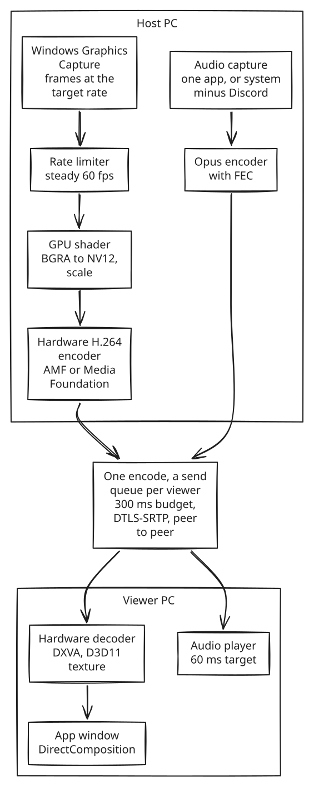
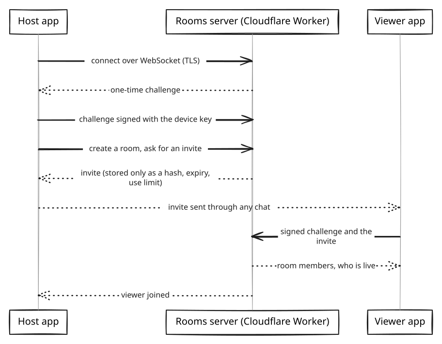

<p align="center"></p>

# nitra

Low-latency screen sharing for Windows, built in Rust for a few friends at a time. You share a game or a window in a room; up to three friends watch it live, peer to peer, while the game keeps running smoothly.

> **Status:** private beta (`0.1.0-beta.1`). Validated on an AMD Radeon RX 7600 with Windows 11. NVIDIA and Intel are experimental (see [Hardware](#hardware)).

## Features

- **Rooms, not calls.** Create a room, send the invite, and everyone in it sees who is online and who is live. Several people can share at once, and you can watch more than one screen side by side, focus one, or go full screen.
- **Share a screen or a single window**, with its own sound: a window shares only its app's audio; a whole screen shares the system sound minus Discord, nitra and any app you exclude.
- **Quality presets:** 720p60 at 6 Mbps (the default), 1080p60, 1080p30 (good for movies) and 1440p60, plus an economy 720p30 at 2 Mbps for slow uploads, with an advanced bitrate setting. The picture keeps its proportions when the source changes shape.
- **Encrypted previews** of each live screen for people in the room who are not watching.
- **Live numbers** on every watched screen: frame rate, bitrate, packet loss, round trip and the connection route (LAN, internet, IPv6). The person sharing sees who is watching, with their loss and round trip. When a direct connection fails, the app says why.
- **Closes like a normal app.** The X closes nitra; while it runs, a tray icon hides and shows the window with one click. It can also stay in the tray when closed, if you prefer.
- **One window per profile**, and clear messages when a shared window closes, a monitor goes away or the PC sleeps.
- **Recovers by itself** from a lost GPU (driver reset), sleep and display changes.

## Install, use and remove

1. Download `nitra.exe` and check its SHA-256 against the one published with it. It is a single file with the C runtime built in; there is no installer.
2. Run it. Windows may show "Windows protected your PC" because the file is not signed: click **More info → Run anyway**.
3. Type your name, create a room and copy the invite to your friends. They paste it in their nitra to join.

nitra keeps its data in one folder, `%LOCALAPPDATA%\nitra`: the device key (protected by Windows DPAPI), your rooms, your settings and the last ten logs. It writes nothing else: no registry keys, temporary files or cache. The settings show the version and have an **Open the logs folder** button for when something goes wrong.

**To remove nitra,** use **Erase my data from this PC** in the settings (it asks first, closes nitra and deletes that folder), then delete `nitra.exe`. Windows itself may keep a firewall rule if you allowed nitra through the firewall; it is harmless.

## Hardware

| GPU | Sharing (encode) | Watching (decode) |
| --- | --- | --- |
| AMD | **Tested** (AMF, RX 7600) | **Tested** |
| NVIDIA | Experimental (Media Foundation / NVENC) | Windows H.264 decoder (DXVA) |
| Intel | Experimental (Media Foundation / Quick Sync) | Windows H.264 decoder (DXVA) |

On a GPU that has not been tested, nitra asks before the first share. nitra never encodes in software, because that would weigh on the game; without a hardware H.264 encoder it says so and suggests updating the driver.

## Known limitations

- **Laptops with two GPUs:** nitra uses the first one, which may be the integrated GPU while the game runs on the other.
- **No relay server:** when strict NAT or a firewall blocks a direct connection on both sides, watching does not start; the app tells you which side is the likely cause. `nat-probe.exe` (in this repository) checks a network in about 25 seconds and reports whether a direct connection is likely, without saving the public IP address.
- **Heavy packet loss:** at 5–10% loss, 1080p keyframes can lose packets that are not recovered, and the picture may freeze for a few seconds (see [Network](#network)).
- Not yet stress-tested over multi-hour sessions or hundreds of start/stop cycles.

## How it works

### The picture and the sound

<picture>
  <source media="(prefers-color-scheme: dark)" srcset="docs/flow/media-dark.svg">
  
</picture>

Frames stay on the GPU from capture to encoder as D3D11 textures; no frame pixels go through CPU memory. One encode serves every viewer. Video and audio share one media clock, so they stay in sync on the viewer.

### Joining a room

<picture>
  <source media="(prefers-color-scheme: dark)" srcset="docs/flow/rooms-dark.svg">
  
</picture>

There are no accounts or passwords. The rooms server is a Cloudflare Worker with one Durable Object per room; it carries sign-in, presence, signaling and sealed previews, never the media.

### Starting to watch

<picture>
  <source media="(prefers-color-scheme: dark)" srcset="docs/flow/watch-dark.svg">
  
</picture>

### Previews

<picture>
  <source media="(prefers-color-scheme: dark)" srcset="docs/flow/preview-dark.svg">
  
</picture>

The diagrams are drawn with Excalidraw; their sources are in [`docs/flow`](docs/flow).

### Key decisions

- **Windows Graphics Capture** over Desktop Duplication: the same or lower game impact at a third of the CPU.
- **A GPU shader** for color conversion and scaling: faster than the video processor (0.22% against 0.30% of the GPU at 1080p60; 0.14% against 0.62% at 720p).
- **AMF** as the AMD encoder: 2.3 ms against 5.9 ms for Media Foundation, which stays the path on other GPUs.
- **str0m** for WebRTC over the `rtc` crate: with 2% packet loss it delivered 1,789 of 1,800 frames at 1.0 ms (p50), against 1,256 at 900 ms, and a late joiner got a keyframe in 101 ms instead of 493 ms.
- **Dear ImGui** for the interface over GPUI: it sleeps when nothing changes (0% CPU against 1.2%, which woke about 650 times a second), opens twice as fast and has no measurable cost in the game, while GPUI cost 4% of the 1% low.
- **Peer to peer, 1–3 viewers,** with no media server and no relay: nothing to pay for or run besides the free Worker.
- **No software encoder fallback:** it would load the CPU and send frame pixels through memory while the game runs.

## Performance design

The goal is a game that stays smooth while it is shared, not the lowest number in isolation. Every choice below was measured, A/B, against the alternative.

**Capture and encode**
- **GPU only, from capture to encoder.** Frames stay as D3D11 textures; color conversion and scaling run in one shader pass into a fixed pool of NV12 textures.
- **Capture only what is sent.** Windows Graphics Capture is asked for frames at the target rate, timed from the captured monitor's refresh rate, instead of every frame the game draws (about 114 per second at 60 fps).
- **A steady 60 fps.** A credit-based rate limiter absorbs the bursts in a game's frame delivery, so no source frame is dropped and viewers get a steady ~59.9 fps.
- **Asynchronous encode with bounded queues.** At most 4 frames are in flight in the encoder; every queue has a fixed size, so nothing grows without limit under load.
- **Instant picture for late joiners.** When the source is minimized or still, the last frame is encoded again on request, so a new viewer never waits on a black screen.

**Network**
- **One encode for everyone.** Each viewer only adds the cost of sending packets: about 4% of one core, roughly 0.25% of the whole processor.
- **Slow links do not hold back the others.** Each viewer has a send budget of 300 ms; a viewer on a slow link skips frames and resumes at the next keyframe, while the encoder follows the slowest viewer that keeps up. Keyframes are limited to one per 500 ms, however many viewers ask.
- **Retransmissions over a wide window.** Lost packets are asked for again over the last ~1 s of video instead of str0m's ~110 ms, so 2–5% loss is repaired without a keyframe or a freeze.
- **Audio that catches up.** Opus with forward error correction and loss concealment. Late audio is capped at 40 ms, and after a network stall the player drops the backlog at once instead of drifting back over half a minute.
- **Malformed or oversized packets are dropped,** never ending the session.

**Watching**
- **One video device for every watched screen.** The decoders run on the window's own D3D11 device instead of one each, so a watched screen costs about 50 MB rather than about 80 MB, with no extra CPU.
- **Hidden screens cost nothing.** A watched screen that is minimized or covered skips drawing: 0% 3D load, 40% fewer wake-ups and 14 MB less video memory.
- **The window goes through the desktop compositor** (DirectComposition), so a maximized window never takes over the monitor's refresh rate and the mouse stays smooth.
- **Nothing runs when nothing changes.** The window sleeps until there is input or a new frame: 0% CPU while idle, and it opens in about 106 ms.

**Rooms server**
- **Rooms sleep between messages.** Each room is a Durable Object with hibernating WebSockets; keepalive pings are answered by the runtime without waking the room, so a quiet room costs one request a minute.

## Benchmarks

Measured on a Ryzen 7 5800XT (16 threads) with an RX 7600, a 320 Hz main monitor and a 144 Hz second monitor. Game results come from Valorant's Practice Range in repeated, alternating rounds, compared with 95% confidence intervals; "no measurable difference" means the interval includes zero. CPU is a percentage of one core, with the share of the whole processor in parentheses where it matters. The methodology is in [`docs/benchmark-protocol.md`](docs/benchmark-protocol.md).

### Impact on the game

Each stage of the share, added one at a time (1080p, 10 Mbps, uncapped, OBS closed):

| Condition | Average FPS | 1% low | Process CPU |
| --- | --- | --- | --- |
| No capture | 635.4 | 398.1 | — |
| Capture only | 601.2 (−5.4%) | 366.2 | 2.5–3.0% |
| Capture + GPU conversion | 600.6 (−5.5%) | 371.5 | 4.4–5.0% |
| Capture + conversion + AMF encode | 594.9 (−6.4%) | 359.7 | 7.7–8.7% |

Almost all of the cost is the capture itself: the game spends longer handing each frame to Windows while it is captured. Conversion and encode add no measurable difference to the average.

Windows Graphics Capture against Desktop Duplication, in the same session (OBS was most likely open, which lowers the baseline):

| Capture | Average FPS | 1% low | Capture process CPU |
| --- | --- | --- | --- |
| None | 569.7 | 342.7 | — |
| Windows Graphics Capture | 560.5 (−1.6%, no measurable difference) | 329.3 | 3.0% (0.19%) |
| Desktop Duplication | 558.0 (−2.1%, measurable) | 329.3 | 9.8% (0.61%) |

### Capture rate

| Frames asked from Windows Graphics Capture | Captured per second | Reach the encoder | Game FPS | Process CPU |
| --- | --- | --- | --- | --- |
| Twice the target rate | 114 | 59.9 fps | 597.4 | 7.9–9.5% |
| At the target rate | 63.4 | 57.6 fps | 603.4 (+1.0%) | 5.8–8.3% |

Asking only for the target rate is cheaper for the game but, on a 320 Hz monitor, lost frames to rounding. The final rule (90% of the shortest frame interval the monitor allows, with a credit-based limiter) keeps the lower rate and the full frame rate: dropped source frames went from 109–135 a minute to **0**, and the viewer gets a steady 59.9 fps.

### Sharing while playing

The full share (capture, conversion, encode and sending to a viewer on another PC) at 720p60, 6 Mbps:

| Scenario | Average FPS | 1% low | Cost |
| --- | --- | --- | --- |
| Uncapped, no OBS | 629 → 594 | 395 → 364 | −5.6% average, −7.8% 1% low |
| Uncapped, OBS replay buffer running | 540 → 522 | 302 → 265 | −3.3% average, −12% 1% low |
| **FPS capped at 300**, OBS replay buffer running | 299.8 → 299.6 | 223 → 218 | **no measurable difference** |

With the game capped, as most people play, the GPU has room to spare: the share only adds about 3% to the game's GPU time per frame and the frame rate does not move.

### Watching while playing

The viewer (hardware decode and presentation in a 1280×720 window on the second monitor) while playing on the main one:

| Stream | Uncapped: average FPS | Uncapped: 1% low | Capped at 300: 1% low |
| --- | --- | --- | --- |
| Nothing | 613.9 | 379.4 | 232.3 |
| 1080p30 | 610.9 (no measurable difference) | 369.8 (−2.5%) | 230.8 (no measurable difference) |
| 1080p60 | 608.4 (no measurable difference) | 365.3 (−3.7%) | 227.5 (no measurable difference) |
| 720p60 | 604.3 (−1.6%) | 360.4 (−5.0%) | 226.6 (−2.5%, borderline) |

Capped at 300, the average stayed at 299.8 in every case. The cost grows with the number of frames shown per second, not with the resolution.

### Alongside OBS

The same GPU encoder shared with an OBS replay buffer (AV1, 1080p60, 6.5 Mbps, high-quality preset), two minutes each, nitra sharing Valorant at 720p60 to a window on the second monitor:

| | OBS alone | OBS + nitra |
| --- | --- | --- |
| GPU video encoder load | 72.0% (peak 76.3%) | 60.6% (peak 61.0%) |
| GPU 3D load | 47.4% | 48.0% |
| OBS frames recorded / rendered | 9,091 / 9,102 | 10,424 / 10,436 |
| OBS encoding lag | none | none |
| nitra | — | 60 fps, 0 dropped, longest gap 59 ms |

The game with OBS recording, without and with nitra sharing (720p60, 6 Mbps):

| Scenario | Average FPS | 1% low | Game CPU / GPU time per frame |
| --- | --- | --- | --- |
| Uncapped, sharing the monitor | 539.6 → 521.5 (−3.35%) | 302.4 → 265 (−12.4%) | +3.2% / +4.2% |
| Uncapped, sharing the monitor (repeated) | 539.5 → 521.6 (−3.31%) | 299.8 → 261 (−12.8%) | — |
| Uncapped, sharing the game's window | 539.5 → 521.9 (−3.26%) | 299.8 → 267 (−11.1%), steadier | — |
| Capped at 300, sharing the window | 299.8 → 299.6 (no measurable difference) | 223.0 → 218 (no measurable difference) | GPU +2.8% |

Capturing the game's window or its whole monitor costs the same; the window gave slightly steadier lows.

### Bitrate: 6 Mbps or 2 Mbps

720p60 at 6 Mbps (the default) against 720p30 at 2 Mbps (the economy preset), on a lossless Practice Range clip:

| Setting | VMAF | VMAF, worst 5% | Sender CPU | Viewer CPU | Game FPS cost |
| --- | --- | --- | --- | --- | --- |
| 720p60 · 6 Mbps | **94.4** | 86.8 | 7.4% (0.46%) | 3.5–4.2% (~0.24%) | −5.6% |
| 720p60 · 3 Mbps | 82.5 | 67.3 | — | — | — |
| 720p60 · 2 Mbps | 70.5 | 48.4 | — | — | — |
| 720p30 · 2 Mbps | 84.2 | 69.3 | 3.3% (0.21%) | 1.6–2.2% (~0.12%) | −4.9% |
| 720p30 · 1.5 Mbps | 76.5 | 57.4 | — | — | — |

VMAF scores how close the picture is to the original (above ~93 looks the same). At a low bitrate, 30 fps keeps each frame sharper than 60 fps; the game pays about the same either way, so the default stays at 6 Mbps and the 2 Mbps preset is there for slow uploads. Memory is the same in both. On the wire, packet headers add about 1.5% to the bitrate.

### Encoder

| Encoder | Latency p50 / p99, 1080p 10 Mbps | Latency p50 / p99, 1080p 20 Mbps | CPU to submit a frame |
| --- | --- | --- | --- |
| AMF | **2.3 / 2.9 ms** | 2.3 / 2.6 ms | 177 µs |
| Media Foundation | 5.9 / 6.2 ms | 5.9 / 6.0 ms | 281 µs |

Both hit the target bitrate (within 1%) with no dropped frame. Quality on a game clip at the same bitrate (Media Foundation / AMF):

| Output | PSNR-Y (dB) | SSIM | VMAF |
| --- | --- | --- | --- |
| 1080p · 6 Mbps | 36.2 / 36.2 | 0.951 / 0.950 | 82.8 / 82.2 |
| 1080p · 10 Mbps | 39.0 / 38.9 | 0.967 / 0.967 | 92.5 / 92.0 |
| 1080p · 20 Mbps | 42.8 / 42.6 | 0.982 / 0.981 | 98.4 / 98.2 |
| 720p · 6 Mbps | 39.6 / 39.5 | 0.969 / 0.969 | 94.7 / 94.4 |

The two encoders run on the same hardware and give the same quality; AMF wins on latency and avoids Media Foundation's intermittent slow mode (about 30 ms per frame). Capture and encode together in the game, 1080p 10 Mbps:

| OBS | AMF | Media Foundation |
| --- | --- | --- |
| Replay buffer running | −2.9% average FPS | −4.6% |
| Closed | −7.0% | −7.4% |

### Conversion and decode

| Step | Result |
| --- | --- |
| BGRA → NV12 shader, 1080p | 36.6 µs of GPU per frame (0.22% of the GPU at 60 fps) |
| BGRA → NV12 shader, 720p scaled | 23.4 µs (0.14%) |
| Hardware decode, 1080p 10 Mbps | 234 µs p50, 476 µs p99 per frame; up to about 930 frames per second |
| Hardware decode, 720p 6 Mbps | 207 µs p50 |

### End to end

From the moment a frame is rendered to the moment it reaches the display, on the same PC (1080p 10 Mbps, measured with PresentMon at the display):

| Encoder | Render → on screen, p50 | p95 | Decoded → on screen, p50 |
| --- | --- | --- | --- |
| AMF | **10.3–11.2 ms** | 23–24 ms | 3.3 ms |
| Media Foundation | 13.4–14.7 ms | 26–27 ms | 3.4 ms |

Between two processes on the same PC, render → decoded is 10.2 ms p50 against 9.7 ms inside one process: the network path adds under 1 ms.

### Host cost per viewer (1080p60, 10 Mbps)

| Viewers | Host CPU | Video encoder load | Render → decoded, p50 |
| --- | --- | --- | --- |
| 1 | 5–6% (0.3–0.4%) | 9.5% | 4.8 ms |
| 3 | 13–15% (0.8–0.9%) | 9.5% | 5.7 ms |
| 5 | 21–23% (1.3–1.4%) | 9.3% | 7.3 ms |

The encode runs once for everyone. Each viewer adds about 4% of one core, roughly 0.25% of the whole processor, almost all of it in the system call that sends each packet.

### Network

Recovery on an impaired network (1080p60, 10 Mbps, two runs):

| Condition | Frames decoded | Longest freeze |
| --- | --- | --- |
| 1% loss | 97–100% | 34–84 ms |
| 5% loss | 83–87% | 1.5–2.4 s |
| 10% loss | 46–65% | 2.7–4.3 s |
| Loss bursts | 96–99% | 0.2–0.65 s |
| 2 s outage | 100% | back about 40 ms after the network returns |
| 50 ± 20 ms delay, 2% reordering | 98–100% | in order |

No frame arrived corrupted in any condition. Packet loss shown in the app matches the simulated loss (5.36% seen for 5% simulated). These runs predate the wider retransmission window; with it, 2–5% loss no longer freezes the picture (see [Packet loss](#packet-loss) below).

### Audio

| Measure | Result |
| --- | --- |
| Sound to ear on the viewer | 56.5 ms p50 (61 ms p95) |
| Audio against the picture | 33 ms after it |
| Sound to decoded, 5% packet loss | 7 ms p50, 48–67 ms p95 |
| Back in sync after a 2 s outage | at once (one gap) |
| Opus encode / decode, per 20 ms block | 166 µs / 42 µs |
| Player over 10 minutes | 0 underruns, 1.9% of one core, 3.3 MB |
| Each app captured | about 0.15% of one core (0.01%), 0.1 MB |

### The viewer

The viewer's cost by stream, out of the game (decode runs on the GPU's separate video engine):

| Stream | GPU 3D | GPU video decode | CPU | Video memory |
| --- | --- | --- | --- | --- |
| 1080p60 | 1.0% | 12.9% | 0.3–5.6% | 112 MB |
| 1080p30 | 0.5% | 7.2% | 0.3–1.1% | 112 MB |
| 720p60 | 0.5% | 7.0% | 2.3–3.5% | 57 MB |
| 720p30 | 0.3% | 3.7% | 0.3–1.2% | 57 MB |

Memory per watched screen, before and after sharing one video device:

| | Before | After |
| --- | --- | --- |
| One screen | 137 MB | 106 MB |
| Two screens | 217 MB | 159 MB |
| Each extra screen | +80 MB, +699 handles, +26 threads | +53 MB, +105 handles, +10 threads |

CPU stayed the same (6.3% of one core with two screens, in alternating rounds), with 0 dropped frames. The window shown through the desktop compositor costs less than one bound to the window: 2.1% of one core instead of 2.9% while watching, with no change in the game (−0.09%).

### The app

| Scenario | Result |
| --- | --- |
| Idle: in or out of a room, minimized or in the tray | 0% CPU, 56 MB |
| Window start | about 106 ms |
| Sharing 720p60 | 2.3–4.3% of one core (0.15–0.27%), 133 MB |
| Sharing and watching at the same time | 8–11% of one core (0.5–0.7%), 217 MB |
| Close while sharing and watching | 0.3–0.4 s |
| Second launch of the same profile | brings the open window forward in 77 ms |
| 10 start/stop cycles of sharing or watching | memory and handles back to the start: no leak |

### Rooms server

| Measure | Result |
| --- | --- |
| Sign in on Cloudflare, room starting cold | 0.91 s |
| Offer and answer over the internet | 330 ms |
| Someone leaves without warning | seen by the others in 160 ms |
| A quiet room | hibernates; wakes twice a minute while someone is connected |
| Encrypted preview | 1–3 ms to make and seal; up to 22 KB for two members |
| Production, end to end | 479–482 frames in 8 s through the deployed Worker |

## Measurements

Not benchmarks of cost, but checks of what a viewer sees: whether frames arrive, how evenly they reach the screen, and how the stream holds up on a bad network. Same PC as above; host and viewer on one PC over loopback unless said otherwise, the network trouble simulated on the viewer's side with a fixed seed so runs can be compared.

### What the app records

While sharing or watching, nitra writes one line to its local log every 10 seconds (about 110 KB an hour per watched screen; nothing leaves the PC). The card's **⋯** button shows the same numbers over the video.

| Side | Numbers |
| --- | --- |
| Sharing | frames captured, encoded and sent per second; frames lost before encode or before sending; bitrate |
| Watching | frames received, decoded and shown per second; frames dropped and replaced; spacing on screen (median, 95th percentile, longest) and the share of long frames (over 1.5× the median); resolution, Mbps, loss, round trip |
| Watching, sound | how long sound takes from arriving to being heard (queue, sound card buffer and the device's own latency); catch-ups, concealed packets, gaps, underruns |

The card's frame rate counts frames shown, not frames decoded. Spacing on screen comes from the swap chain's frame-latency signal: the frame statistics a windowed swap chain gets from DXGI follow the main display, matching about 90% of frames there and about 1% on a second monitor at another refresh rate. Against them, on the main monitor, the signal gives the same median and 95th percentile (16.3 vs 15.6 ms, 33.2 vs 34.4 ms).

### Frames from a real game

Valorant's window shared at 1080p60, 10 Mbps, to a viewer decoding on the same PC (320 Hz monitor), 120 s:

| Stage | Result |
| --- | --- |
| Captured, encoded, sent | 59.6–60.2 fps in every 10 s line, nothing lost |
| Received, decoded | 59.8–60.2 fps, 7,207 frames, 0 dropped |
| Longest gap | 81 ms, once |

The synthetic test window used elsewhere does not reach its own screen at an even 60 fps on a 320 Hz monitor (7.7% long frames before any capture); the capture delivers what is on screen, with no frame dropped by the limiter.

### Sound over a long session

30 minutes of synthetic picture and sound, the viewer playing:

| Measure | Result |
| --- | --- |
| Arrival to heard | 45.0–46.1 ms from start to end |
| Sound against the picture | 34.7 ms after it |
| Catch-ups, concealed packets, gaps | 0 |
| Underruns | 1, at the start |
| Sound card clock drift | +48 ppm, compensated |

The player never holds more than its 60 ms target plus 40 ms: any more is dropped at once, so the delay cannot grow with time.

### Packet loss

1080p60, 10 Mbps, 60 s per run, before and after the wider retransmission window (two runs at each loss rate):

| Condition | Frames skipped | Keyframe requests | Longest freeze | Shown fps |
| --- | --- | --- | --- | --- |
| No trouble | 0 | 1 | 34–42 ms | 58–60 |
| 2% loss, before | 78–194 | 8–15 | 0.15–1.5 s | 46–57 |
| **2% loss, after** | **0** | **1** | **35–192 ms** | 48–57 |
| 5% loss, before | 466–505 | 35–38 | 1.1–1.6 s | 26–52 |
| **5% loss, after** | **0–2** | **1–2** | **35–68 ms** | 48–52 |
| Loss bursts (10 packets, ~1.7%) | 3 → 0 | 2 → 1 | 83 → 59 ms | 56–58 |
| 2 s outage | 6–25 | 2 | the outage itself | back at once |

A viewer that only receives has no round trip from RTP, so str0m retries a lost packet every 105 ms, and it tracked only the last 100 packets (about 110 ms at 10 Mbps): a lost request or a lost retransmission fell out of the window before the retry, and became a keyframe request and a freeze. nitra carries str0m with that window raised to 1,000 packets ([`vendor/str0m`](vendor/str0m/NITRA.md)) and lets video wait for retransmissions over as many. Frames that waited still arrive together, so 24–44% of frames stay long on screen at 2–5% loss.

### Smoothing

Each viewer picks how much delay to trade for smoothness (Settings → "Ao assistir"); the default is automatic. Frames are shown at their capture time plus a short hold, instead of as soon as they arrive. 1080p60, 10 Mbps, 60 s per run:

| Condition | Mode | Long frames | Spacing p95 | Frames shown | Hold (added delay) |
| --- | --- | --- | --- | --- | --- |
| No trouble | Minimum delay | 10–17% | 31–34 ms | 3,672 | 0 |
| No trouble | Smooth | 7–10% | 29–31 ms | 3,673 | 31 ms |
| No trouble | Automatic | 9–13% | 31 ms | 3,653 | 10–16 ms |
| 2% loss | Minimum delay | 24–29% | 47–48 ms | 3,413 | 0 |
| 2% loss | Smooth | 13–16% | 31 ms | 3,655 | 31 ms |
| 2% loss | Automatic | 12–15% | 31 ms | 3,648 | 28–31 ms |
| 5% loss | Minimum delay | 40–42% | 50–60 ms | 3,166 | 0 |
| 5% loss | Smooth | 13–16% | 32–34 ms | 3,605 | 31 ms |
| 5% loss | Automatic | 15–19% | 31–36 ms | 3,544 | 31 ms |

The hold is at most two frames (~33 ms at 60 fps); automatic raises it at once to cover 95% of recent arrivals and lowers it about 2 ms a second. The test window's own unevenness (see above) is why it holds 10–16 ms even with no network trouble. The viewer's CPU was the same in every mode (2.8–3.6 s of one core per minute, about 5%); up to three frames wait in GPU textures, about 6 MB more video memory per watched screen at 1080p.

### A link slower than the stream

| Link (10 Mbps stream) | Frames shown in 60 s | Longest freeze | Keyframe requests | Encoder changes |
| --- | --- | --- | --- | --- |
| 6 Mbps, encoder at 100% of the estimate | 1,699–2,201 | 1.9–3.3 s | 41–75 | 53–74 |
| **6 Mbps, at 85%, rising in steps** | **3,250** | **0.99 s** | **13** | 26 |
| 3 Mbps, encoder at 100% of the estimate | 1,606–1,917 | 3.1–3.2 s | 63–68 | 38–79 |
| **3 Mbps, at 85%, rising in steps** | **2,761** | **1.1 s** | **31** | 35 |

At 100% of the bandwidth estimate (the pacer sends about 10% above it, and keyframes come in bursts) the bottleneck's queue overflowed, keyframes overflowed it again and the viewer kept asking for new ones. The encoder now gets 85% of the estimate, follows a drop at once and rises only after 2 s, by at most 15% a step: on 6 Mbps the picture holds 58–60 fps between drops. After a deep drop the climb back takes about half a minute. On good links nothing changes (10 Mbps, no encoder change, in the same runs).

## Security

- **No accounts or passwords.** Each device has a key pair; the private key is protected by Windows DPAPI. Rooms sign you in by challenge–response with that key.
- **Signed messages** with expiry and replay protection. Manual invites work once; room invites are stored only as hashes, with an expiry and a use limit.
- **Encrypted media**, peer to peer (DTLS-SRTP). Previews are sealed for each room member (X25519 and AES-256-GCM), and the server cannot open them.
- **No IP addresses in the logs.** Connection details are logged as kinds and routes only, and the Worker keeps no request logs. `scripts/check-logs.ps1` checks logs for addresses, invites, e-mails and secrets.
- **Hardened against malformed input:** fuzz tests on every parser of outside data (room protocol, invites, signed envelopes, STUN, profile files, previews), from 1,000 to 50,000 mutated inputs each. Previews accept JPEG only. Oversized datagrams are dropped instead of ending the session. STUN transaction ids come from the system's cryptographic random generator.
- **Dependencies audited** with `cargo audit`: 147 dependencies, 0 known vulnerabilities.
- **GPU safety:** only documented user-mode APIs. nitra never touches clocks, voltages, power limits, drivers or the TDR settings.

## Building

Requirements: Windows 10 or 11, the Rust toolchain pinned in `rust-toolchain.toml`, and static libopus and FreeType from vcpkg (the C runtime is linked in, see `.cargo/config.toml`):

```powershell
vcpkg install opus:x64-windows-static freetype[core]:x64-windows-static
cargo build --release -p nitra
.\scripts\check.ps1
```

`check.ps1` runs formatting, clippy and the test suite. A normal build is a development build, with its own data folder (`nitra-dev`) and the development rooms server; setting `NITRA_CHANNEL=beta` at build time makes the beta build. The rooms Worker lives in `worker/` (TypeScript, Wrangler, Node.js 22 or newer).

The interface font is [Inter](https://github.com/rsms/inter) and the logo uses Bricolage Grotesque, both under the SIL Open Font License; Inter is built into the executable from `apps/nitra/assets/fonts` (license in `OFL.txt` there).
